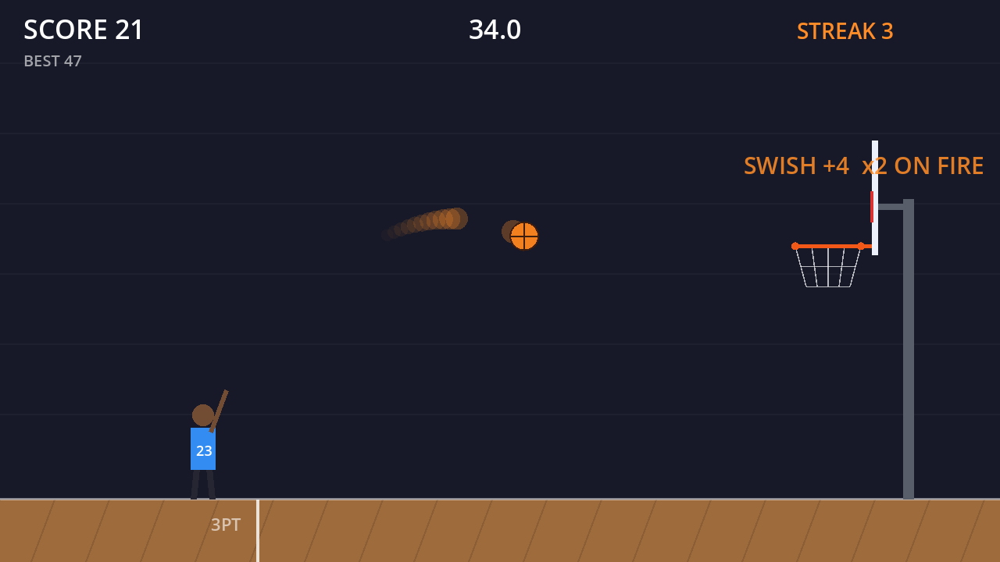

# Hoop Rush

A 60-second 2D basketball shooter built in Godot 4.3 with GDScript.

**[▶ Play in your browser](https://kalebkebede-dev.github.io/hoop-rush/)** (desktop, mouse and keyboard)

## Controls
| Input | Action |
|---|---|
| **A / D** or **arrow keys** | Move |
| **Mouse** | Aim |
| **Hold left click** | Charge the shot (the meter ping-pongs, so time your release) |
| **Release** | Shoot |
| **R** or **Space** | Play again after the round |

## Rules
- 2 points per make, 3 from behind the 3PT line
- Swish (no rim touch): +1
- 3 makes in a row puts you on fire for double points
- Each make adds 1.5 s to the clock
- At 10 points the hoop starts moving; at 25 it moves farther
- High score saves between sessions

## How it works
- **Game loop:** a small state machine (menu, playing, game over) in `main.gd` drives the game each frame.
- **Ball physics:** custom gravity with 4 substeps per frame so fast shots can't tunnel through the rim.
- **Collisions:** each rim edge is a small circle; the ball reflects off it with restitution, and the backboard is a vertical segment.
- **Scoring:** a basket counts when the ball's center crosses rim height moving downward between the rim edges. Rim contact is tracked to detect swishes.
- **Aim assist:** a short dotted preview shows the start of the arc, so aiming is learnable but the make still depends on the player.
- **Rendering:** everything is drawn in code with `_draw()`, so the project needs no image assets.
- **Persistence:** the high score is stored with `ConfigFile` in `user://`.

## Run locally
1. Download [Godot 4.3](https://godotengine.org/download) (standard version).
2. Open Godot, click **Import**, and select this folder's `project.godot`.
3. Press **F5** to play.

The web build in `docs/` is exported with the included `Web` preset (threads off, so it runs on GitHub Pages).

## Roadmap
- [ ] Sound effects for shots, rim hits and swishes
- [ ] Sprites and a shooting animation
- [ ] Difficulty levels or a moving defender
- [ ] Touch controls for mobile

## License
MIT
